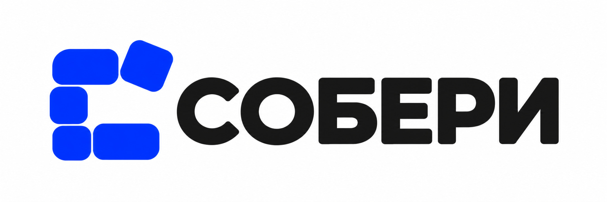
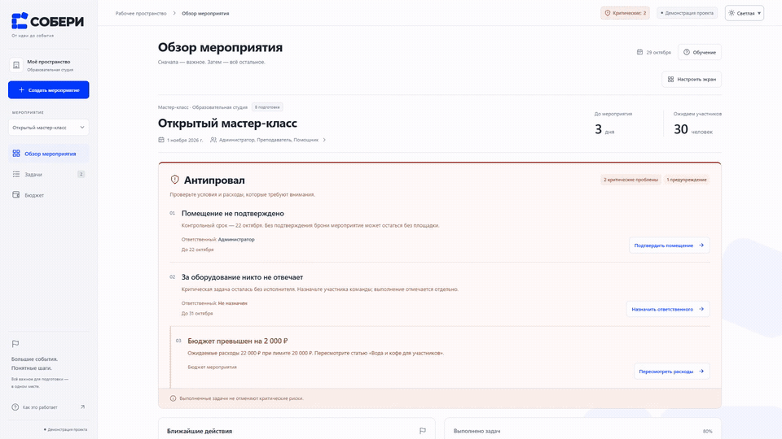
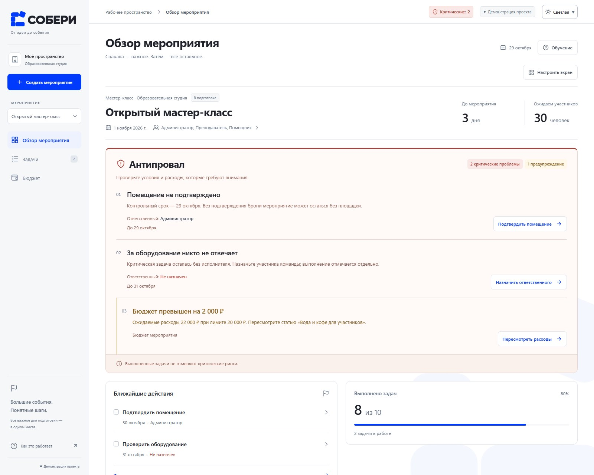
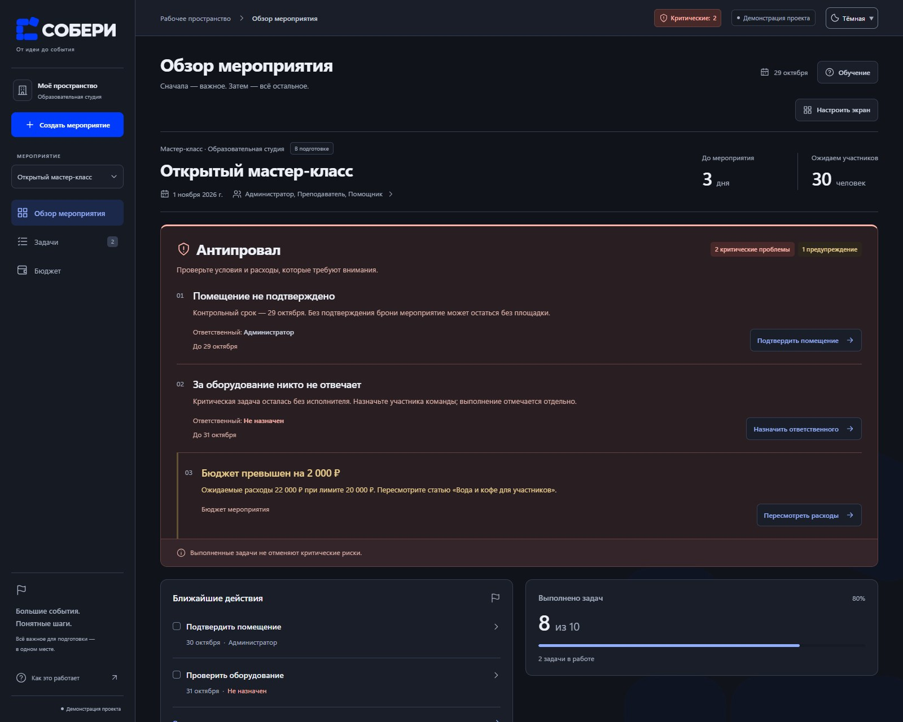
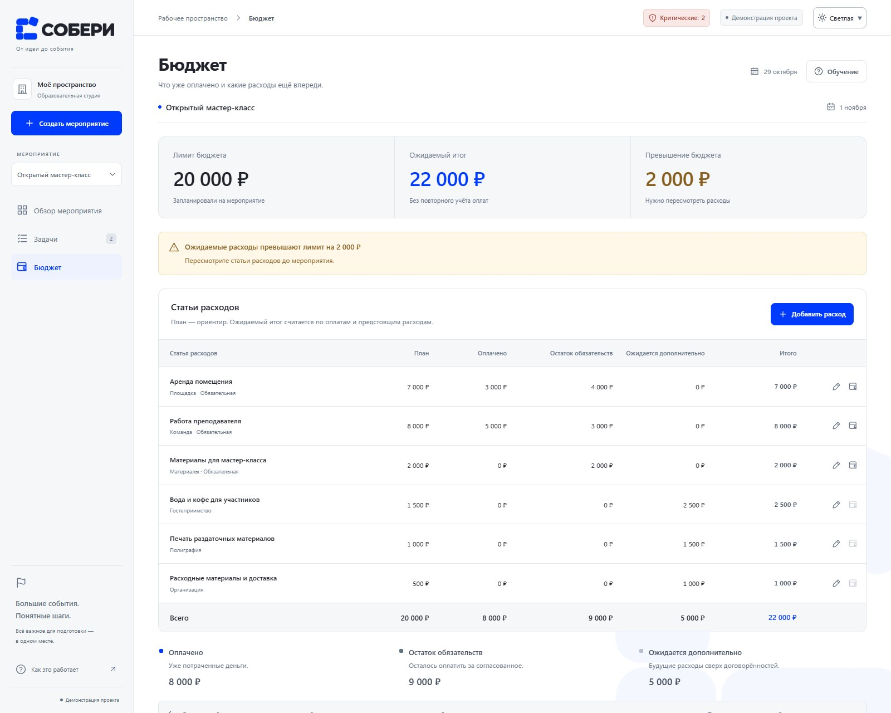
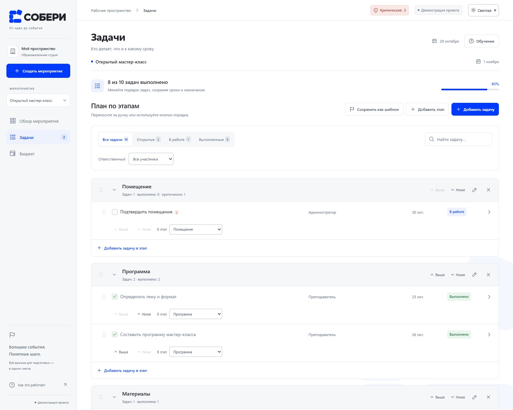
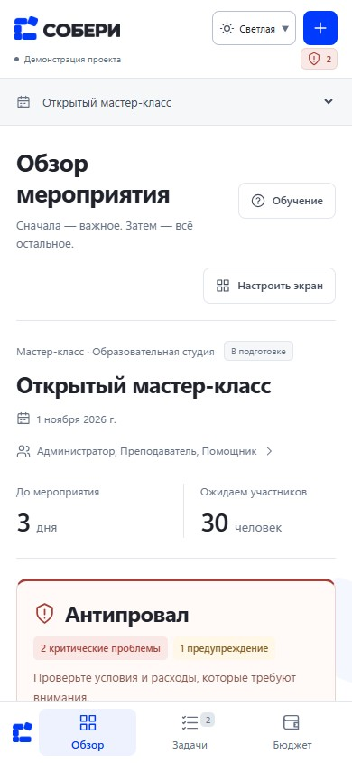

<div align="center">



### От идеи до события

**План, команда и бюджет — в одном рабочем пространстве.**  
Подготовка небольших мероприятий с вниманием к критическим пропускам.

[](https://react.dev/)
[](https://www.typescriptlang.org/)
[](https://vite.dev/)
[](#данные-и-границы-демонстрации)

[Видеодемонстрация](#видеодемонстрация) · [Возможности](#что-умеет-собери) · [Запуск](#быстрый-старт) · [Проверки](#проверки)

</div>

## Зачем СОБЕРИ

СОБЕРИ помогает образовательным студиям, небольшим центрам и студенческим командам готовить мастер-классы, встречи и другие небольшие события.

Закрытые задачи показывают объём выполненной работы. **«Антипровал» отдельно показывает условия, которые ещё могут сорвать мероприятие**: неподтверждённое помещение, критическую задачу без ответственного, просрочку или проблемы с расходами.

> В примере выполнены 8 из 10 задач, но помещение ещё не подтверждено, а за оборудование никто не отвечает. Высокий процент выполнения не скрывает эти проблемы.

## Видеодемонстрация

<div align="center">

[](docs/media/soberi-demo.mp4)

**[Открыть полное видео](docs/media/soberi-demo.mp4)** · **[Скачать MP4](https://github.com/MihaylovvvR1/soberi/raw/refs/heads/main/docs/media/soberi-demo.mp4)**  
44,5 секунды · 1920×1080 · без звука

</div>

В ролике — реальные действия в приложении: создание из шаблона, назначение исполнителя и смена статуса, устранение риска, пересчёт бюджета, перенос блока и ночная тема. GIF выше — короткое превью; полная последовательность доступна в MP4.

## Что умеет СОБЕРИ

| Возможность | Как помогает подготовке |
| --- | --- |
| **Обзор и «Антипровал»** | Показывают проблему, её причину, ответственного и следующий шаг. Из предупреждения можно открыть нужную задачу или расход. |
| **План по этапам** | Этапы и задачи можно добавлять, редактировать, сворачивать и переставлять. Сроки и назначения сохраняются при переносе. |
| **Команда и задачи** | У каждой задачи есть статус, срок, исполнитель и критичность. Доступны поиск, фильтры и подтверждение удаления. |
| **Бюджет** | План, оплачено, остаток обязательств и дополнительные расходы учитываются раздельно. Частичная оплата не удваивает ожидаемый итог. |
| **Свои шаблоны** | Сохраняют структуру подготовки, команду и плановые статьи. Новое событие получает новую дату и отдельные данные, без выполненных статусов и фактических оплат. |
| **Настройка обзора** | Можно менять порядок и ширину блоков, скрывать и возвращать их. Скрытый «Антипровал» продолжает проверять риски. |
| **Обучение внутри интерфейса** | Семь шагов с подсветкой элементов. Практика проверяет реальные действия и проходит на отдельном учебном примере. |
| **Три режима темы** | Светлая, тёмная и системная темы. На телефоне — компактная навигация и одна колонка. |

Перетаскивание имеет альтернативы: кнопки **«Выше» / «Ниже»** и выбор этапа задачи. Интерфейс поддерживает клавиатуру, заметный фокус и уменьшение анимаций.

## Интерфейс

### Обзор мероприятия



<details>
<summary><strong>Ночная тема, бюджет, план и мобильная версия</strong></summary>

### Ночная тема



### Бюджет



### План по этапам



### Телефон



</details>

## Быстрый старт

Нужен **Node.js 24 или новее**. Установка сервера и база данных не требуются.

```bash
git clone https://github.com/MihaylovvvR1/soberi.git
cd soberi
npm ci
npm run dev
```

Откройте **http://localhost:5173**. При первом посещении можно пройти обучение или сразу начать работу.

```bash
npm run build     # production-сборка
npm run preview   # локальный просмотр сборки
```

## Подготовленный пример

**«Открытый мастер-класс»** — образовательная студия, 30 участников и команда из администратора, преподавателя и помощника. Дата устанавливается через три дня после первого запуска.

| Показатель | Значение |
| --- | ---: |
| Выполнено задач | 8 из 10 |
| Критические проблемы | 2 |
| Лимит бюджета | 20 000 ₽ |
| Оплачено | 8 000 ₽ |
| Остаток обязательств | 9 000 ₽ |
| Дополнительные ожидаемые расходы | 5 000 ₽ |
| **Ожидаемый итог** | **22 000 ₽** |

Ожидаемый итог = оплачено + остаток обязательств + дополнительные расходы. План хранится отдельно; неизвестная стоимость отличается от нуля.

Кнопка **«Восстановить пример»** возвращает его исходные данные с подтверждением и сохраняет другие созданные мероприятия.

## Проверки

```bash
npm run test:model  # правила, расчёты, миграции и восстановление
npm test            # браузерные сценарии Playwright
```

При финальной проверке прошли **27 модельных проверок и 31 браузерный сценарий**. Проверены основные действия, изоляция мероприятий, шаблоны, конструкторы, обучение, темы, сохранение и повреждённые локальные данные.

На Windows конфигурация использует установленный Chrome, если он доступен по стандартному пути. На других системах установите браузер Playwright:

```bash
npx playwright install chromium
npm test
```

Путь к другому Chrome можно передать переменной `SOBERI_BROWSER_PATH`. Проверка интерфейса выполнена в Chrome на размерах 1920×1080, 1366×768 и 390×844; дополнительные сценарии охватывают ширины от 320 px.

[Подробный отчёт о проверке и её ограничениях →](docs/final-review.md)

## Данные и границы демонстрации

Это **интерактивный прототип бизнес-идеи**. Регистрация, сервер, реальные платежи и внешние API не подключены.

- События, их команды, задачи и расходы хранятся локально в браузере и разделены между мероприятиями.
- Расположение обзора и выбор темы сохраняются отдельно от данных событий.
- Учебный пример временный: после выхода возвращается прежнее мероприятие, пользовательские данные не меняются.
- Перед восстановлением старого или повреждённого состояния исходная строка резервируется. Полностью нечитаемый JSON нельзя достоверно восстановить автоматически.
- Firefox, Safari и реальные сенсорные устройства отдельно не проверялись.

Оригинальный логотип и его синий цвет **#003AFD** сохранены. В тёмной теме знак остаётся синим, название становится светлым; один фоновый знак имеет прозрачность 4%.

## Структура проекта

```text
src/             интерфейс, общее состояние и правила подготовки
public/brand/    оригинальный логотип и подготовленные графические части
tests/           браузерные сценарии
model-tests/     проверки правил и расчётов
scripts/         визуальная проверка и воспроизводимая запись видео
docs/            описание реализации, отчёт и медиа
```

[Техническое описание](docs/implementation.md) · [Локальная разработка и запись](docs/local-development.md) · [Сценарий обучения](docs/onboarding.md)

---

<div align="center">

**СОБЕРИ — чтобы всё получилось.**  
Проект [MihaylovvvR1](https://github.com/MihaylovvvR1)

</div>
